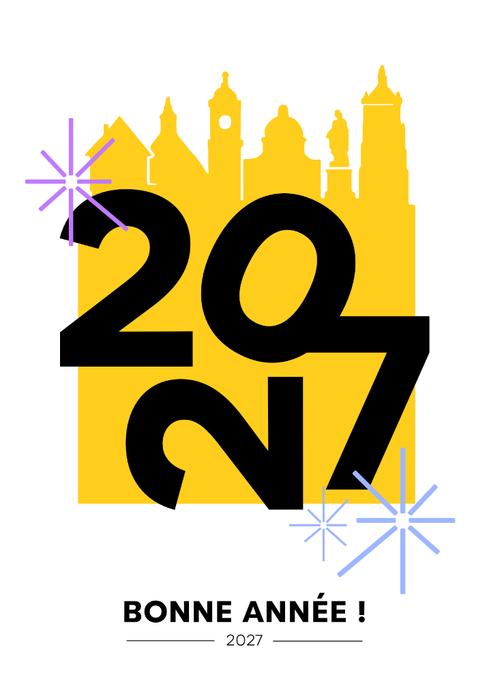

# ✨ Carte de Vœux 2027 • Réalité Augmentée (WebAR) 🎆

> Expérience WebAR festive et interactive : scannez l'image de la carte de vœux pour faire apparaître **« BONNE ANNÉE ! 2027 » en 3D relief doré** ainsi que des **feux d'artifice 3D spectaculaires** qui explosent tout autour avec effets sonores !

---

## 🌟 Fonctionnalités

- 📱 **WebAR Direct (Sans Application)** : Fonctionne instantanément dans le navigateur web de votre smartphone (Safari sur iOS, Chrome sur Android) et sur PC via webcam.
- 🎯 **Reconnaissance d'Image Ultra-Précise** : Basé sur **MindAR.js** & **A-Frame / Three.js** avec le fichier de tracking pré-compilé `targets.mind`.
- 🔤 **Texte 3D Doré Métallique en Relief** :
  - `BONNE ANNÉE !` sculpté en 3D avec biseau doré et reflets métalliques.
  - Chiffres `2027` en 3D chromé.
  - Étoiles scintillantes 3D à 8 branches en rotation (violette & bleue, fidèles au graphisme de la carte).
  - Poussières d'étoiles dorées flottantes.
- 🎆 **Système de Feux d'Artifice 3D Particulaires** :
  - Fusées qui décollent depuis la carte et explosent en altitude.
  - Éruptions sphériques de 100+ particules lumineuses avec gravité et traînées.
  - Palette festive vibrante : or impérial, violet néon, cyan céleste et étincelles blanches.
  - Éclairage dynamique : chaque explosion illumine la carte et le texte 3D !
  - Salve d'ouverture (Grand Finale) dès la détection de la carte.
- 🔊 **Moteur Audio Procédural (Web Audio API)** :
  - Aucun fichier audio externe requis (100% fiable et sans latence).
  - Fanfare de carillons célestes à la détection.
  - Bruitages de tir, déflagrations sourdes et crépitements de braises.
  - Bouton Activer / Couper le son dans l'interface.
- 📸 **Capture Photo Souvenir** : Bouton pour immortaliser l'instant et télécharger la photo avec la carte et les feux d'artifice en 3D.
- 🚀 **Déploiement Automatisé GitHub Pages** : Workflow GitHub Actions inclus pour une mise en ligne en 1 clic.

---

## 🖼️ Image Cible à Scanner

L'expérience réagit à l'image suivante (`card-target.png`) :

<p align="center">
  
</p>

> **Astuce :** Vous pouvez soit imprimer cette carte, soit l'afficher sur l'écran d'un ordinateur ou d'une tablette et la viser avec votre smartphone.

---

## 🚀 Démarrage Rapide en Local

### Prérequis
- [Node.js](https://nodejs.org/) (v18 ou supérieur)
- npm

### 1. Installation
```bash
npm install
```

### 2. Lancement du Serveur de Développement (avec HTTPS local)
Les navigateurs mobiles nécessitent obligatoirement une connexion sécurisée (HTTPS ou localhost) pour autoriser l'accès à la caméra. Le projet intègre le plugin Vite Basic-SSL :

```bash
npm run dev
```

Vite affichera deux adresses :
- `https://localhost:5173/` (pour tester sur votre ordinateur)
- `https://192.168.x.x:5173/` (l'adresse locale sur votre réseau Wi-Fi)

> **Pour tester sur votre smartphone :**
> Connectez votre smartphone au même réseau Wi-Fi que votre ordinateur, ouvrez Safari ou Chrome, et tapez l'adresse `https://192.168.x.x:5173/`. Acceptez le certificat de développement local, autorisez la caméra, et visez la carte !

---

## 🌐 Déploiement sur GitHub & GitHub Pages

Pour héberger gratuitement votre expérience en ligne et la partager facilement :

### 1. Initialiser le dépôt Git et pousser sur GitHub
```bash
git init
git add .
git commit -m "feat: initial commit AR Bonne Année 2027"
git branch -M main
git remote add origin https://github.com/VOTRE_NOM_UTILISATEUR/VOTRE_NOM_DE_REPO.git
git push -u origin main
```

### 2. Activer GitHub Pages
1. Rendez-vous sur votre dépôt GitHub.
2. Allez dans l'onglet **Settings** > **Pages**.
3. Dans **Build and deployment** > **Source**, choisissez **GitHub Actions**.
4. Le workflow automatique `.github/workflows/deploy.yml` va automatiquement compiler et publier votre site à l'adresse :
   `https://VOTRE_NOM_UTILISATEUR.github.io/VOTRE_NOM_DE_REPO/`

Partagez simplement le lien à vos proches ou générez un QR code pointant vers cette URL !

---

## 📂 Structure du Projet

```
ar-bonne-annee/
├── .github/
│   └── workflows/
│       └── deploy.yml          # Déploiement automatique GitHub Pages
├── public/
│   ├── assets/
│   │   ├── fonts/
│   │   │   └── helvetiker_bold.typeface.json  # Police 3D Three.js
│   │   └── vendor/
│   │       ├── aframe.min.js                  # A-Frame 1.5.0
│   │       ├── mindar-image-aframe.prod.js    # MindAR WebAR engine
│   │       └── aframe-text-geometry-component.min.js
│   ├── card-target.png         # Image de la carte originale
│   └── targets.mind            # Descripteurs de tracking AR compilés
├── src/
│   ├── audio.js                # Synthétiseur sonore Web Audio API
│   ├── fireworks.js            # Contrôleur 3D de feux d'artifice particulaires
│   ├── text-3d.js              # Contrôleur 3D texte, étoiles 8 branches & étincelles
│   └── main.js                 # Logique principale, événements MindAR & UI
├── index.html                  # Scène A-Frame et interface utilisateur
├── style.css                   # Styles festifs sombres & dorés glassmorphism
├── vite.config.js              # Configuration Vite avec HTTPS
├── package.json                # Dépendances et scripts de build
└── README.md                   # Documentation complète
```

---

## 🛠️ Personnalisation

- **Couleurs des feux d'artifice** : Modifiez la table `PALETTES` dans [src/fireworks.js](src/fireworks.js).
- **Texte 3D** : Modifiez les balises `<a-entity text-geometry="...">` dans [index.html](index.html).
- **Fréquence des tirs** : Ajustez `this.launchInterval` dans [src/fireworks.js](src/fireworks.js).

---

## 📄 Licence
Projet open-source distribué sous licence MIT.
