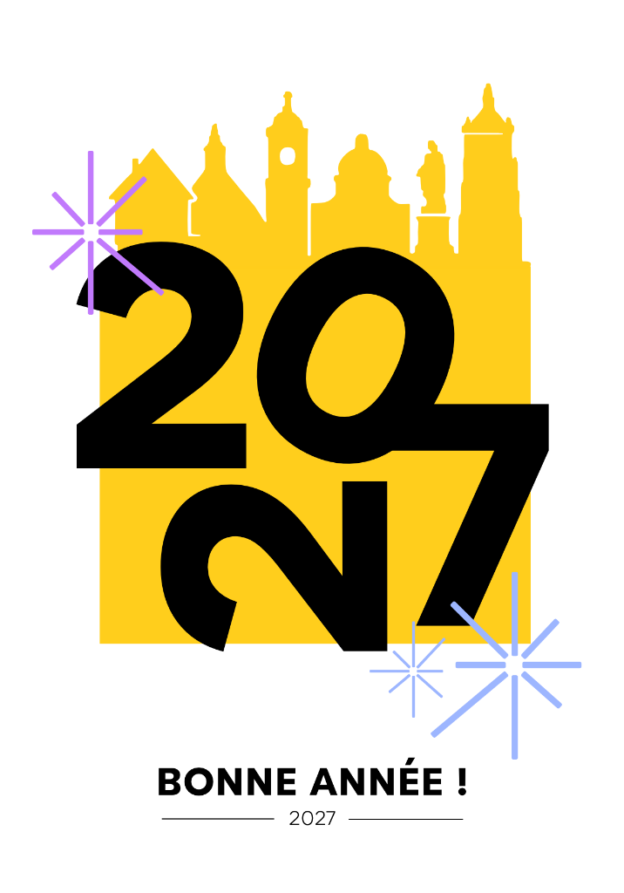

# 🎆 Réveillon 2027 - Feux d'artifice en Réalité Augmentée (WebAR)

Projet WebAR interactif développé avec **MindAR**, **A-Frame** et **Three.js**.  
Quand l'affiche officielle **"2027 BONNE ANNÉE !"** est scannée avec la caméra :
1. Le modèle animé **`fireworks_2027_ar.glb`** apparaît sur l'affiche et joue tous ses clips d'animation jusqu'à leur fin.
2. Si l'affiche est perdue puis reconnue à nouveau, l'animation complète repart du début.

---

## 📱 Tester en direct (WebAR)

👉 **Lien direct GitHub Pages :**  
[https://atsuuuuuuu.github.io/ar-bonne-annee-2027/](https://atsuuuuuuu.github.io/ar-bonne-annee-2027/)

---

## 🎯 Image cible à scanner

Pointez votre caméra vers cette affiche pour déclencher l'expérience AR :

<p align="center">
  
</p>

---

## 💻 Démarrage en local

Si vous souhaitez tester en local sur votre machine :

```bash
# Cloner le dépôt
git clone https://github.com/Atsuuuuuuu/ar-bonne-annee-2027.git
cd ar-bonne-annee-2027

# Lancer le serveur local (HTTP & HTTPS)
node server.js
```

Puis ouvrez :
- Sur votre ordinateur : `http://localhost:8080`
- Sur mobile (même Wi-Fi) : `https://<VOTRE_IP_LOCALE>:8443`

---

## 🛠️ Technologies utilisées

- [MindAR](https://hiukim.github.io/mind-ar-js-doc/) : Moteur de tracking d'image WebAR léger et rapide.
- [A-Frame](https://aframe.io/) & [Three.js](https://threejs.org/) : Rendu 3D.
- **Format GLB (glTF 2.0)** : Modèle 3D animé avec matériaux PBR métalliques et textures dorées.
